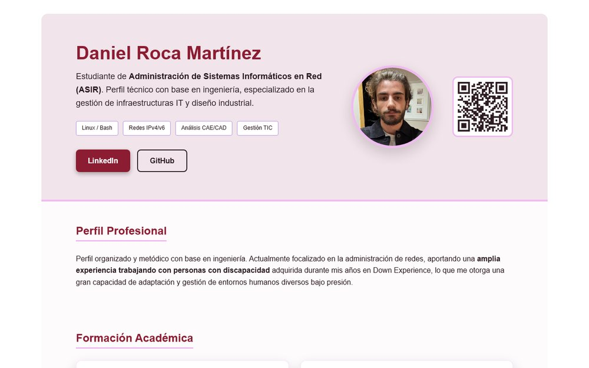
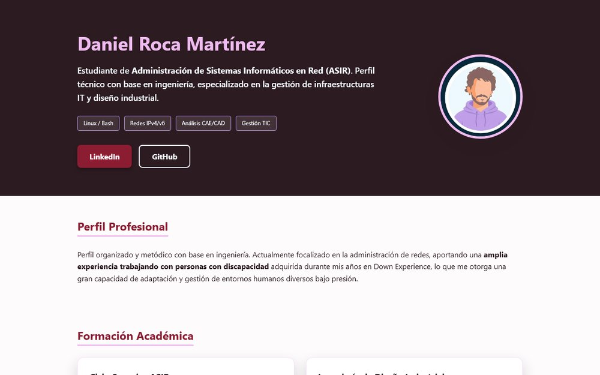
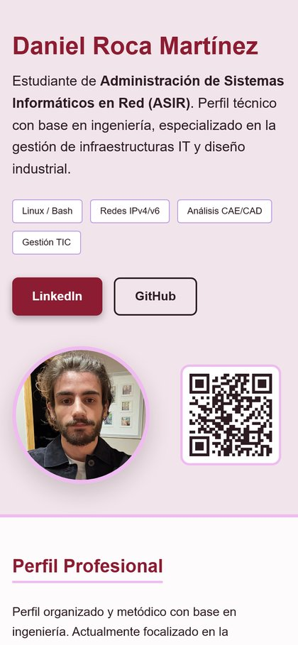

# Práctica HTML y CSS: portfolio con Flexbox

Portfolio profesional responsivo maquetado con **HTML5 semántico** y **CSS Flexbox**. Empezó como la práctica de la 2.ª evaluación de *Lenguajes de Marcas* (1.º de ASIR, Liceo La Paz) y hoy es mi **currículum en la web**: [daniroca5.gamer.gd/cv](https://daniroca5.gamer.gd/cv/).

## El enunciado

La práctica pedía un portfolio personal con una estructura fija y el estilo libre. Las condiciones eran:

- **HTML semántico y válido en el W3C**: `header`, `main`, `section`, `article` y `footer`, sin `div` innecesarios. Un código sin validar o mal indentado suspendía directamente.
- **Flexbox** para toda la disposición, con `flex-wrap` para que se adapte a cualquier pantalla.
- Una sección de **tarjetas de proyectos** con título, descripción y enlace (mejor a GitHub).
- **Hover** para dar foco a los elementos, **variables CSS** para la paleta y un **comentario** antes de cada regla.

## Dos versiones en este repositorio

| Carpeta | Qué es |
|---|---|
| `/` (raíz) | La **práctica tal como se entregó**: `index.html`, `css/css.css` e `img/`. |
| `cv/` | La **versión actual**, que es la del currículum de la web y su PDF. |

La entrega original tenía la cabecera oscura y un avatar dibujado:

## Cómo evolucionó hasta el CV actual

- **Diseño claro**, a juego con el PDF: cabecera y pie rosa claro, tipografía Arial y la misma paleta en variables (`--berry-dark`, `--accent-red`, `--plum-web`…).
- **Foto real y un código QR** que lleva a mi web de apuntes de ASIR.
- **Proyectos con enlace real**: cada tarjeta apunta a su repositorio público de GitHub.
- **Un único origen para la web y el PDF.** El PDF (`cv/CVRocaDaniel.pdf`) se genera imprimiendo la misma página con Chromium. Las reglas `@media print` cambian lo que debe cambiar en papel:
  - los botones se sustituyen por las **direcciones escritas**, para que sirvan si se imprime;
  - se quitan sombras y transparencias, que algunos visores de PDF pintan como rectángulos grises;
  - se fijan las columnas, y el script elige la escala para que **las páginas queden llenas, sin huecos**.
- **Móvil**: en pantallas estrechas las tarjetas pasan a una columna y no hay scroll lateral.

## Lo que aprendí

- Pensar la **estructura semántica** antes que el aspecto: el HTML se entiende solo, sin CSS.
- Que con **Flexbox y `flex-wrap`** se hace casi todo el diseño adaptable sin necesitar *media queries* para cada caso.
- Que **`overflow: hidden` en el `body` se aplica a toda la ventana** y bloquea el scroll en el móvil: un error real que corregí en la versión publicada.
- Que **CSS para imprimir** es otra disciplina: márgenes, saltos de página (`break-inside: avoid`) y colores exactos (`print-color-adjust`).

## Verlo en local

Abrir `index.html` (la práctica) o `cv/index.html` (el CV) en el navegador. No necesita servidor ni dependencias.

---

Daniel Roca Martínez · [Currículum](https://daniroca5.gamer.gd/cv/) · [LinkedIn](https://www.linkedin.com/in/daniel-r-m-02b369164/) · [GitHub](https://github.com/daniroca5)
